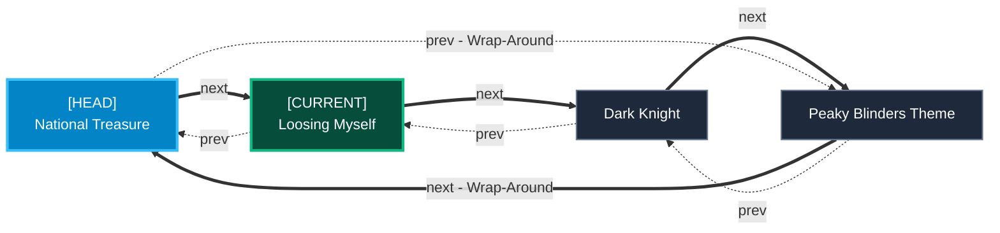

# 🎵 Smart Music Playlist — Circular & Doubly Linked List Engine

[](https://isocpp.org/)
[](#-data-structures-architecture--pointer-mechanics)
[](#-asymptotic-complexity-analysis)
[](#-interactive-web-audio-visualizer)
[](LICENSE)

An asymptotic $\mathcal{O}(1)$ dynamic music playlist sequencer built in **C++** using **Circular Singly and Doubly Linked Lists**. Featuring constant-time bidirectional track traversal, pointer-stitching splice insertion, safe circular round-robin iteration without boundary exceptions, a standalone **Interactive Web Audio Visualizer**, and an **ANSI Terminal Interface**.

---

## 📖 Table of Contents
- [Project Overview](#-project-overview)
- [Data Structures Architecture & Pointer Mechanics](#-data-structures-architecture--pointer-mechanics)
  - [1. Node Memory Layout](#1-node-memory-layout)
  - [2. Circular Splice Insertion (O(1))](#2-circular-splice-insertion-o1)
  - [3. Safe Circular Deletion & Link Re-wiring](#3-safe-circular-deletion--link-re-wiring)
  - [4. Round-Robin Complete Traversal](#4-round-robin-complete-traversal)
- [Edge Cases & Boundary Management](#-edge-cases--boundary-management)
- [Asymptotic Complexity Analysis](#-asymptotic-complexity-analysis)
- [Interactive Web Audio Visualizer](#-interactive-web-audio-visualizer)
- [Building & Running the C++ Engine](#-building--running-the-c-engine)
- [Repository Structure](#-repository-structure)
- [Academic Metadata & Authors](#-academic-metadata--authors)

---

## 🎧 Project Overview

Traditional sequential audio playlists implemented via contiguous arrays (`std::vector` or raw buffers) suffer from two fundamental algorithmic flaws:
1. **Costly Splices:** Inserting or deleting a track in the middle of a $10,000$-song library forces an $\mathcal{O}(N)$ memory shift of all trailing elements.
2. **Boundary Branching:** Looping from the final track back to the first requires explicit modulo or boundary branch checks (`if (idx >= size) idx = 0;`).

**Smart Music Playlist** resolves both problems using heap-allocated **Circular Linked Lists**:
* Pointers stitch dynamically: `insertAfterCurrent()` and `deleteCurrent()` execute in strictly $\mathcal{O}(1)$ time with zero array reallocation.
* The tail node natively points to `head`, yielding continuous wrap-around without conditional jumps.

---

## 🧬 Data Structures Architecture & Pointer Mechanics



### 1. Node Memory Layout
Each song is an independent heap entity storing metadata and bidirectional link pointers:
```cpp
struct Node {
    string song;
    Node* next;
    Node* prev;

    Node(string title) : song(title), next(nullptr), prev(nullptr) {}
};
```

### 2. Circular Splice Insertion ($\mathcal{O}(1)$)
When inserting a new song immediately after the currently playing track:
```cpp
Node* newNode = new Node(title);
newNode->next = current->next;
newNode->prev = current;
current->next->prev = newNode;
current->next = newNode;
size++;
```
*Zero array shifting. Four pointer assignments. Constant time.*

### 3. Safe Circular Deletion & Link Re-wiring
When deleting the currently playing song:
```cpp
Node* toDelete = current;
current->prev->next = current->next;
current->next->prev = current->prev;

if (current == head) {
    head = current->next;
}
current = current->next; // Seamlessly advance to next song
delete toDelete;
size--;
```

### 4. Round-Robin Complete Traversal
To play one full cycle across the entire playlist without falling into an infinite loop:
```cpp
Node* temp = current;
do {
    cout << "Playing: " << temp->song << endl;
    temp = temp->next;
} while (temp != current); // Halts deterministically upon returning to origin
```

---

## 🛡️ Edge Cases & Boundary Management

| Edge Scenario | State Description | Mathematical Resolution |
| :--- | :--- | :--- |
| **Empty Playlist** | `head == nullptr, size == 0` | Guard statements return immediately; operations gracefully report status |
| **Single-Song Playlist** | `size == 1` | `node->next = node; node->prev = node;` self-loops without dangling pointers |
| **Deleting Only Node** | Deleting when `size == 1` | Node deleted; `head` and `current` safely reset to `nullptr` |
| **Deleting Head Node** | `current == head && size > 1` | `head` dynamically advances to `current->next`; tail `next` updated |
| **Infinite Loop Guard** | Traversal on Circular List | `do-while` construct anchored to start pointer ensures exactly $N$ iterations |

---

## ⏱️ Asymptotic Complexity Analysis

| Operation | Dynamic Array (`std::vector`) | Singly Linked List | **Smart Playlist (Circular Doubly)** |
| :--- | :---: | :---: | :---: |
| **Play Next (`current->next`)** | $\mathcal{O}(1)$ | $\mathcal{O}(1)$ | **$\mathcal{O}(1)$** |
| **Play Previous (`current->prev`)** | $\mathcal{O}(1)$ | $\mathcal{O}(N)$ *(traversal required)* | **$\mathcal{O}(1)$** |
| **Insert After Current** | $\mathcal{O}(N)$ *(memory copy)* | $\mathcal{O}(1)$ | **$\mathcal{O}(1)$** |
| **Delete Current Song** | $\mathcal{O}(N)$ *(memory copy)* | $\mathcal{O}(N)$ *(find predecessor)* | **$\mathcal{O}(1)$** |
| **Wrap-Around to Head** | $\mathcal{O}(1)$ *(branch check)* | $\mathcal{O}(1)$ *(branch check)* | **$\mathcal{O}(1)$ *(Native Pointer)*** |
| **Search by Title** | $\mathcal{O}(N)$ | $\mathcal{O}(N)$ | **$\mathcal{O}(N)$** |

---

## 🌐 Interactive Web Audio Visualizer

The project includes an interactive web visualizer located at `web/index.html`:
* **Live Circular Canvas:** An SVG ring rendering dynamically positioned nodes with curved vector arrows illustrating `next` and wrap-around links.
* **Live Pointer Inspection:** Visual glow highlighting the `HEAD` and active `CURRENT` nodes.
* **Live Audio Synthesizer:** Web Audio API generating real ambient synthwave tones that play as vinyl spins.
* **Real-time Operations:** Add, insert after current, delete, and step forward/backward to watch pointer links re-wire on the canvas in real time.

Open `web/index.html` in any modern web browser to interact immediately!

---

## 💻 Building & Running the C++ Engine

### Compile & Run with g++ (Linux / macOS / Windows MinGW)
```bash
cd src
g++ -std=c++17 -O3 main.cpp -o playlist_engine
./playlist_engine
```

### Console Output Preview (ANSI Terminal)
```text
========================================================================
   ____                      _     __  __           _      
  / ___|_ __ ___   __ _ _ __| |_  |  \/  |_   _ ___(_) ___ 
  \___ \ '_ ` _ \ / _` | '__| __| | |\/| | | | / __| |/ __|
   ___) | | | | | (_| | |  | |_  | |  | | |_| \__ \ | (__ 
  |____/|_| |_| |_|\__,_|_|   \__| |_|  |_|\__,_|___/_|\___|
========================================================================

  Circular & Doubly Linked List Engine • Asymptotic O(1) Traversal

  === 🎵 CURRENT SMART PLAYLIST TOPOLOGY (3 Tracks) ===
  ▶ [1] National Treasure (CURRENT)  ⇄      [2] Loosing Myself  ⇄      [3] Dark Knight  ⇄  (Back to Head)

  [CIRCULAR ROUND-ROBIN] Playing 1 complete cycle from current:
    1. 🎶 National Treasure
    2. 🎶 Loosing Myself
    3. 🎶 Dark Knight
  [COMPLETE] Safely returned to starting track: National Treasure
```

---

## 📁 Repository Structure

```
Smart-Music-Playlist-DS-Engine/
├── README.md                            # Complete algorithmic documentation
├── .gitignore                           # Git exclusion rules
│
├── web/
│   └── index.html                       # Standalone Interactive Audio Canvas & Visualizer
│
├── src/
│   ├── main.cpp                         # Enhanced C++ engine with ANSI styling
│   └── original_playlist.cpp            # Original university submission
│
├── docs/
│   ├── Smart_Music_Playlist_...docx     # University assignment report
│   └── ...DataStructures_...pdf         # Formal academic submission PDF
│
└── assets/                              # Diagrams and visualizations
```

---

## 👥 Academic Metadata & Authors

* **Course:** CS210 — Data Structures & Algorithms (BSDS – 3rd Semester)
* **Institution:** Air University Islamabad, Department of Creative Technology
* **Instructor:** Ma'am Umme Sadima
* **Lead Author:** **Muhammad Ahad Ali** (Registration ID: `2503605`)
